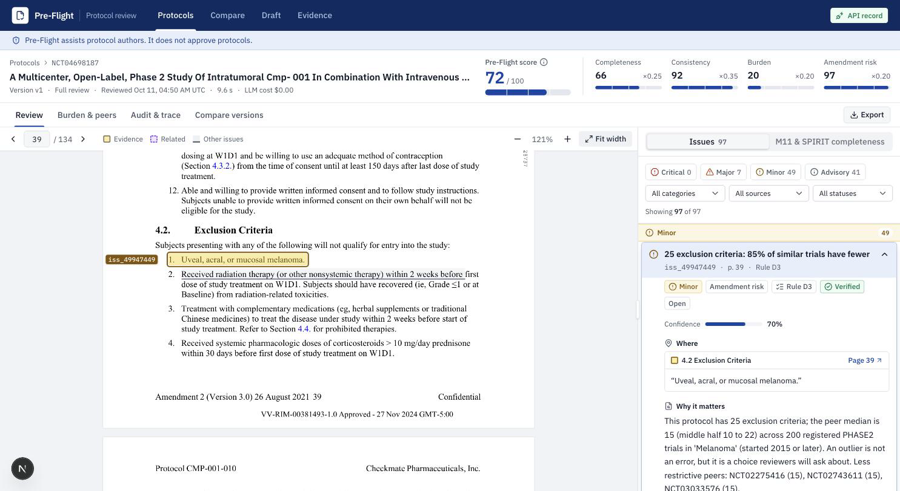
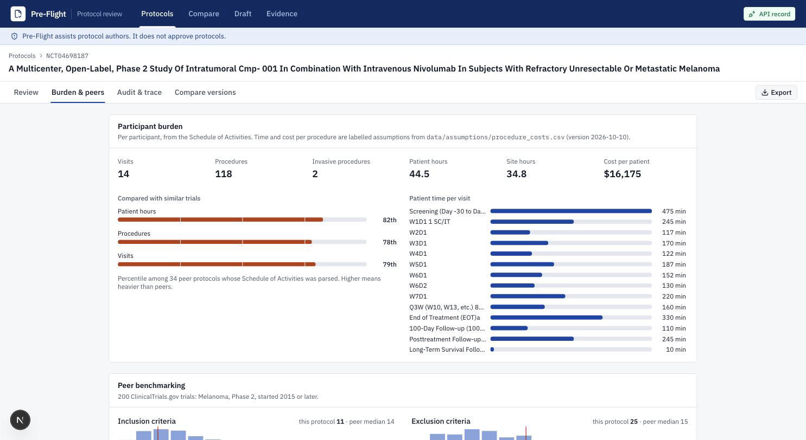
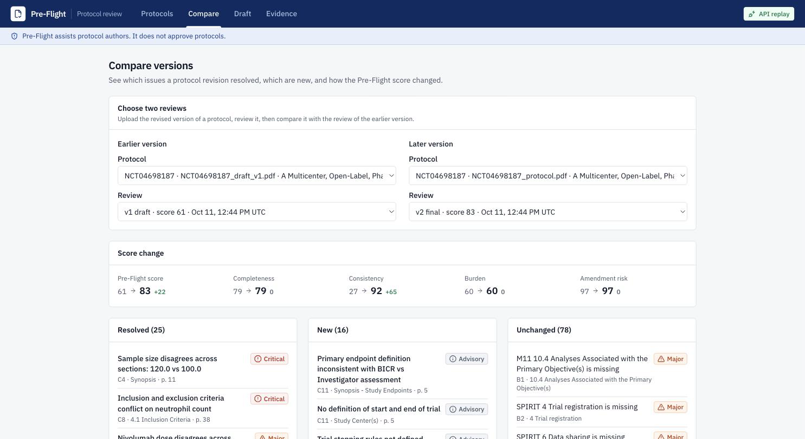
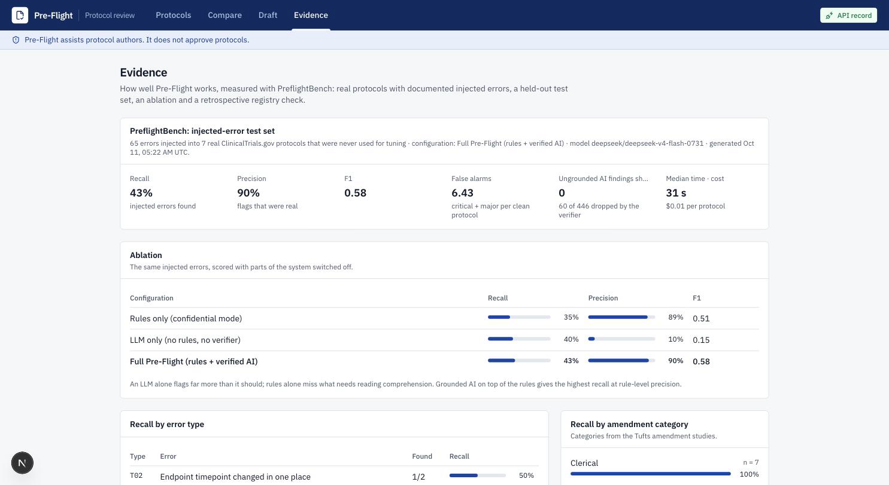

# Protocol Pre-Flight

**Catch avoidable protocol amendments before a trial starts.** Pre-Flight reviews a clinical trial protocol the way a
committee of medical writers, clinical scientists, statisticians and operations leads would: it checks completeness
against ICH M11 and SPIRIT 2025, cross-checks the protocol's internal logic, measures participant burden against similar
trials on ClinicalTrials.gov, and explains every finding with where it is, why it matters and how to fix it.

> Pre-Flight assists protocol authors. It does not approve protocols.

57% of protocols have at least one substantial amendment and 45% of those were judged avoidable; a single amendment costs a
median $141,000 (Phase II) to $535,000 (Phase III) and adds about three months (Getz et al. 2016; Applied Clinical Trials).

**Live demo:** https://trialwright.tech · API: https://api.trialwright.tech/api/health



## What it does

| | Feature |
|---|---|
| Parse | PDF (or Protocol Graph JSON) into sections with page coordinates, mapped to the ICH M11 table of contents; Schedule of Activities extracted into a visit × procedure matrix; objectives, endpoints, eligibility, arms and statistics into a structured **Protocol Graph** |
| Completeness | Present / thin / missing against ICH M11 (official template) and the 34 SPIRIT 2025 items, with page references; "thin" is defined by required sub-elements |
| Consistency | Endpoint timepoint without a matching SoA visit or procedure; orphan procedures; objectives without endpoints and endpoints without analyses; numbers that disagree across sections (ages, doses, sample size, ratio, arms); blinding without an unblinding procedure; overlapping visit windows and durations that no longer add up; eligibility and lab-threshold contradictions (with unit normalisation); sample size not reproducible from its stated assumptions; broken cross-references; protocol vs ClinicalTrials.gov record |
| AI review committee | Four reviewers (medical writer, clinical scientist, biostatistician, clinical ops) run in parallel. **Every AI finding must quote text that is found on the page it cites**, or it is dropped before you see it |
| Burden and peers | Visits, procedures, patient and site hours and cost per participant (labelled assumptions), compared with up to 200 similar trials; amendment-risk hotspots such as eligibility stricter than 85% of peers; precedent table |
| Score | One Pre-Flight score (0-100) from four transparent sub-scores: completeness, consistency, burden, amendment risk |
| Human in the loop | Accept or reject every finding with a note; the score updates; full audit trail |
| Versions | Upload a revised protocol and see which issues were resolved, which are new, and how the score changed |
| Co-author | A short design brief becomes an ICH M11-structured draft that cites precedent trials, with a sample size from a statistical calculator (never the model); Pre-Flight then checks its own draft |
| Exports | Issue report (PDF/CSV), clean M11 .docx, USDM JSON |
| Private uploads | No accounts: each browser keeps a random workspace id, so your uploads appear only in your own list (the demo protocol is visible to everyone). Review links can still be shared |
| Confidential mode | Rules only: no language model is called and nothing leaves the machine |

| Burden & peers | Compare versions | Evidence |
|---|---|---|
|  |  |  |

## Quickstart (no API key needed)

```bash
git clone https://github.com/Yash-Lalwani/TrialWright.git && cd TrialWright
cp .env.example .env
docker compose up --build
```

Open http://localhost:3000 and upload a protocol PDF. The demo protocol is **NCT04698187** (CMP-001 + nivolumab in
advanced melanoma, Phase 2, Regeneron):

```bash
cd backend && uv run preflight fetch --split dev   # downloads it to data/corpus/NCT04698187_protocol.pdf
```

`LLM_MODE=replay` is the default: the AI steps are served from the committed response cache (`data/llm_cache/`), so the
demo protocol and every benchmark protocol reproduce exactly without a key. Other uploads get the rule checks; set
`OPENROUTER_API_KEY` and `LLM_MODE=record` in `.env` to run the AI reviewers live.

### Without Docker

```bash
cd backend && uv sync && uv run preflight serve            # API on :8000
cd frontend && npm ci && NEXT_PUBLIC_USE_MOCKS=false npm run dev   # UI on :3000
```

Command line:

```bash
cd backend
uv run preflight check ../data/corpus/NCT04698187_protocol.pdf            # full review, prints issues with pages
uv run preflight check ../data/corpus/NCT04698187_protocol.pdf --rules-only
uv run preflight check file.pdf --dump-graph                               # the Protocol Graph as JSON
```

## How well it works

**PreflightBench** injects documented errors (18 types, from "endpoint visit removed from the SoA" to "lab threshold
conflicts") into real ClinicalTrials.gov protocols and scores what Pre-Flight finds. The test set (7 protocols, 65 errors)
was never used for tuning. Full numbers: [docs/RESULTS.md](docs/RESULTS.md).

| Configuration (test set) | Recall | Precision | F1 |
|---|---|---|---|
| Rules only (confidential mode) | 35% | 88% | 0.51 |
| LLM only (one generic prompt) | 40% | 10% | 0.15 |
| **Pre-Flight (rules + LLM + verifier)** | **43%** | **90%** | **0.58** |

An LLM alone flags far too much; rules alone miss what needs reading comprehension. Grounded AI on top of the rules gives
the best of both. On the dev set the full system reaches 70% recall at 95% precision; the gap to the test set is the honest
measure of generalisation. The verifier shows **zero ungrounded AI findings**. A retrospective check on 200 melanoma
trials' registry histories found that trials later relaxing their inclusion criteria had 4.4 times the odds of having been
flagged as outliers beforehand (p = 0.003; exploratory, see the caveats in RESULTS).

Reproduce:

```bash
cd backend
uv run preflight fetch                         # corpus PDFs from data/corpus/manifest.csv
uv run preflight inject --set test             # regenerates injected PDFs from the committed answer keys
uv run preflight bench --set test --config full
```

## Architecture

```
PDF / JSON ──▶ Ingest ──▶ Protocol Graph ──┬──▶ Rules engine (B1-B3, C1-C10) ──┐
              (PyMuPDF,    (Pydantic,      ├──▶ AI review committee ──▶ Verifier ├──▶ Merge, score ──▶ Issues + Score
               pdfplumber)  USDM-aligned)  └──▶ Burden + peers + hotspots ──────┘        │
                                                (ClinicalTrials.gov API v2)              ▼
                                   FastAPI (REST + SSE) ◀──▶ Next.js workspace · exports · audit trail
```

- **Backend:** Python 3.12, FastAPI, Pydantic, SQLite, PyMuPDF, pdfplumber, rapidfuzz, statsmodels, pint, python-docx.
- **LLM:** `deepseek/deepseek-v4-flash-0731` via OpenRouter with JSON-schema output, a record/replay cache and per-call cost logging. The model extracts and reviews; it never does arithmetic or scoring.
- **Frontend:** Next.js, TypeScript, Tailwind, react-pdf with highlight overlays.
- **Packaging:** Docker, docker-compose, GitHub Actions (lint, tests, both containers smoke-tested), Jenkinsfile, MIT license. Deployed on Railway.

Design documents: [PRD](docs/PRD.md) · [Architecture](docs/ARCHITECTURE.md) · [API contracts](docs/CONTRACTS.md) ·
[Evaluation plan](docs/EVALUATION.md) · [Results](docs/RESULTS.md) · [Build plan](docs/BUILD_PLAN.md) ·
[Demo script](docs/DEMO_SCRIPT.md)

## Data and sources

All data is public or synthetic.

- Protocols and registry records: [ClinicalTrials.gov API v2](https://clinicaltrials.gov/data-api/api) (corpus listed in `data/corpus/manifest.csv`; PDFs are downloaded, not committed)
- [ICH M11 template](https://database.ich.org/sites/default/files/ICH_Step4_M11_Final_Template_2025_1119.pdf) → `data/standards/m11_toc.yaml`; [SPIRIT 2025](https://www.ncbi.nlm.nih.gov/pmc/articles/PMC12035670/) → `data/standards/spirit2025.yaml`
- [CDISC USDM / DDF-RA](https://github.com/cdisc-org/DDF-RA) for the JSON export
- Procedure time and cost: labelled assumptions in `data/assumptions/procedure_costs.csv`
- Amendment statistics: Getz KA et al., *Therapeutic Innovation & Regulatory Science* 2016; cycle time: Applied Clinical Trials

## Limitations

- Recall on unseen protocols is about 43%; checks were tuned on three development protocols. Errors that need deep reading (a deleted endpoint, a removed analysis) are mostly missed.
- Flags on clean protocols have not been adjudicated by clinicians; some may be real issues, some false alarms.
- Burden uses assumed procedure times and costs; peer comparison depends on how complete the ClinicalTrials.gov records are.
- Uploads other than the demo and benchmark protocols get AI review only with an API key; without one, the rule checks still run.
- Workspaces are privacy, not security: anyone with a review link can open it, and clearing browser storage starts a new, empty workspace.
- Not measured in this release: human reviewer baseline, clinician-rated precision on real findings, SoA cell accuracy.

## License

[MIT](LICENSE)
