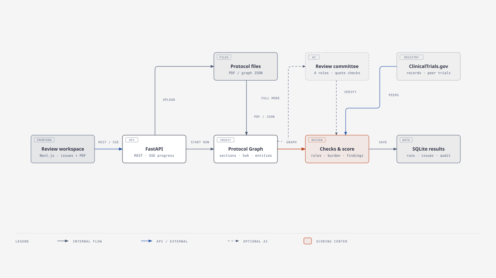
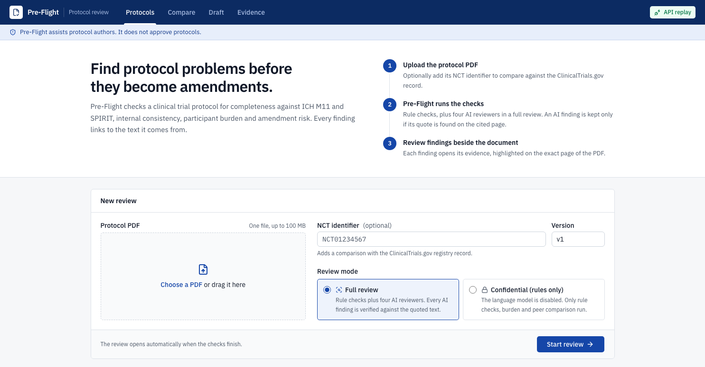
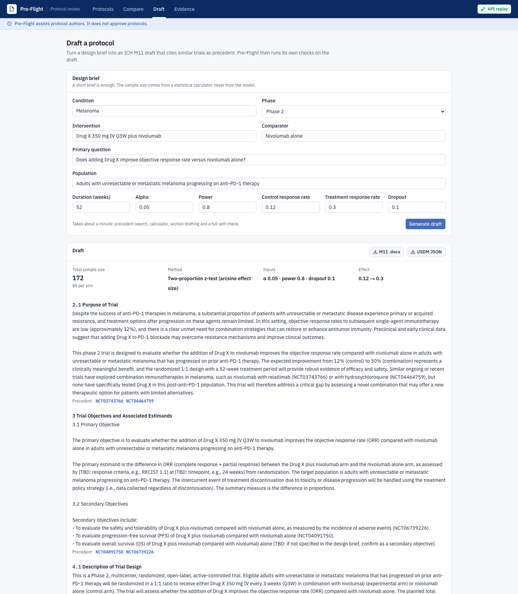

# Protocol Pre-Flight

## The problem and the solution

Late changes to clinical trial protocols are expensive: [Tufts CSDD found that 45% of substantial amendments were avoidable, and one Phase III amendment cost a median $535,000](https://pubmed.ncbi.nlm.nih.gov/30227022/). Pre-Flight helps teams catch missing requirements, contradictions and participant-burden risks **before a trial starts**. It checks a protocol against ICH M11 and SPIRIT 2025, compares it with peer trials, and ties each finding to the page that supports it.

**Live demo:** [trialwright.tech](https://trialwright.tech) · [Start a protocol review](https://trialwright.tech/protocol) · [API health](https://api.trialwright.tech/api/health)

## Architecture at a glance



[Open the diagram at full size](docs/images/trialwright-architecture.svg) · [Explore the interactive architecture](https://trialwright.tech/architecture.html) · [Diagram Design source](diagram-design/trialwright-architecture.html)


## What it does

| | Feature |
|---|---|
| Parse | PDF (or Protocol Graph JSON) into sections with page coordinates, mapped to the ICH M11 table of contents; Schedule of Activities extracted into a visit × procedure matrix; objectives, endpoints, eligibility, arms and statistics into a structured **Protocol Graph** |
| Completeness | Present / thin / missing against ICH M11 (official template) and the 34 SPIRIT 2025 items, with page references; "thin" is defined by required sub-elements |
| Consistency | Endpoint timepoint without a matching SoA visit or procedure; orphan procedures; objectives without endpoints and endpoints without analyses; numbers that disagree across sections (ages, doses, sample size, ratio, arms); blinding without an unblinding procedure; overlapping visit windows and durations that no longer add up; eligibility and lab-threshold contradictions (with unit normalisation); sample size not reproducible from its stated assumptions; broken cross-references; protocol vs ClinicalTrials.gov record |
| AI review committee | Four reviewers (medical writer, clinical scientist, biostatistician, clinical ops) run in parallel. **Every AI finding must quote text that is found on the page it cites**, or it is dropped before you see it |
| Burden and peers | Visits, procedures, patient and site hours and cost per participant (labelled assumptions), compared with up to 200 similar trials; amendment-risk hotspots such as eligibility stricter than 85% of peers; precedent table |
| Score | One Pre-Flight score (0-100) from four transparent sub-scores: completeness, consistency, burden, amendment risk |
| Human in the loop | Accept or reject every finding with a note; the score updates; full audit trail |
| Versions | Upload a revised protocol and see which issues were resolved, which are new, and how the score changed |
| Co-author | A short design brief becomes an ICH M11-structured draft that cites precedent trials, with a sample size from a statistical calculator (never the model); Pre-Flight then checks its own draft |
| Exports | Issue report (PDF/CSV), clean M11 .docx, USDM JSON |
| Private uploads | No accounts: each browser keeps a random workspace id, so your uploads appear only in your own list (the demo protocol is visible to everyone). Review links can still be shared |
| Confidential mode | Rules only: no language model is called. The PDF still goes to the app server for analysis |

| Burden & peers | Compare versions | Evidence |
|---|---|---|
|  |  |  |

| Upload (full or confidential mode) | Co-author: brief to checked M11 draft |
|---|---|
|  |  |

## Quickstart (no API key needed)

```bash
git clone https://github.com/Yash-Lalwani/TrialWright.git && cd TrialWright
cp .env.example .env
docker compose up --build
```

Open http://localhost:3000/protocol and upload a protocol PDF. The demo protocol is **NCT04698187** (CMP-001 + nivolumab in
advanced melanoma, Phase 2, Regeneron):

```bash
cd backend && uv run preflight fetch --split dev   # downloads it to data/corpus/NCT04698187_protocol.pdf
```

`LLM_MODE=replay` is the default: the AI steps are served from the committed response cache (`data/llm_cache/`), so the
demo protocol and every benchmark protocol reproduce exactly without a key. Other uploads get the rule checks; set
`OPENROUTER_API_KEY` and `LLM_MODE=record` in `.env` to run the AI reviewers live.

### Without Docker

```bash
cd backend && uv sync && uv run preflight serve            # API on :8000
cd frontend && npm ci && NEXT_PUBLIC_USE_MOCKS=false npm run dev   # UI on :3000
```

Command line:

```bash
cd backend
uv run preflight check ../data/corpus/NCT04698187_protocol.pdf            # full review, prints issues with pages
uv run preflight check ../data/corpus/NCT04698187_protocol.pdf --rules-only
uv run preflight check file.pdf --dump-graph                               # the Protocol Graph as JSON
```

## How well it works

On seven held-out ClinicalTrials.gov protocols with 65 injected errors, Pre-Flight found 43% of errors at 90% precision. A bare AI prompt found 40% at 10% precision, making Pre-Flight **9× more precise** in this test. [Full methods and caveats](docs/RESULTS.md).

| Result | Evidence |
|---|---|
| **0 ungrounded AI citations shown** | The page-quote verifier rejected 60 of 446 AI findings; independent checking found no ungrounded quotes among the 386 shown. |
| **31s and <1¢ per review** | Median 30.5 seconds and $0.0065 in provider-reported model cost, measured live across seven protocols. |
| **25 issues resolved in one revision** | The [demo comparison](docs/DEMO_SCRIPT.md) shows a score change from 70 to 84. |
| **91% fewer false alarms on a real amended protocol** | Rule fixes reduced approximately 23 incorrect findings to 2 across two TRUNCATE-TB versions. |
| **4.4× eligibility signal** | Trials that later relaxed inclusion criteria had 4.44× the odds of a prior outlier flag in an exploratory check of 200 melanoma trial registry histories. |

Confidential mode runs rules only and makes **no model calls**. The 4.4× result is a peer-outlier signal, not a measured reduction in future amendments.

Reproduce:

```bash
cd backend
uv run preflight fetch                         # corpus PDFs from data/corpus/manifest.csv
uv run preflight inject --set test             # regenerates injected PDFs from the committed answer keys
uv run preflight bench --set test --config full
```

## Real amended protocol

We also checked the original and amended **TRUNCATE-TB** protocols (NCT03474198) without tuning on them. Fixing rule errors reduced approximately 23 incorrect findings across the two versions to 2, a **91% reduction**. Compare versions tracks changes in findings; it does not identify every text change in an amendment.

Design documents: [PRD](docs/PRD.md) · [Technical architecture](docs/ARCHITECTURE.md) · [API contracts](docs/CONTRACTS.md) ·
[Evaluation plan](docs/EVALUATION.md) · [Results](docs/RESULTS.md) · [Build plan](docs/BUILD_PLAN.md) ·
[Demo script](docs/DEMO_SCRIPT.md)

## Data and sources

All data is public or synthetic.

- Protocols and registry records: [ClinicalTrials.gov API v2](https://clinicaltrials.gov/data-api/api) (corpus listed in `data/corpus/manifest.csv`; PDFs are downloaded, not committed)
- [ICH M11 template](https://database.ich.org/sites/default/files/ICH_Step4_M11_Final_Template_2025_1119.pdf) → `data/standards/m11_toc.yaml`; [SPIRIT 2025](https://www.ncbi.nlm.nih.gov/pmc/articles/PMC12035670/) → `data/standards/spirit2025.yaml`
- [CDISC USDM / DDF-RA](https://github.com/cdisc-org/DDF-RA) for the JSON export
- Procedure time and cost: labelled assumptions in `data/assumptions/procedure_costs.csv`
- Amendment statistics: Getz KA et al., *Therapeutic Innovation & Regulatory Science* 2016; cycle time: Applied Clinical Trials

## Limitations

- Older protocols may predate the ICH M11 template; their different section structure can cause missing-section flags.
- There is no sign-in. Your browser stores a workspace ID that controls which reviews appear in your list; the protocols and scores are stored on the server, and review links can be shared.
- Burden estimates use assumed procedure times and costs. Peer comparisons depend on the completeness of ClinicalTrials.gov records.

## License

[MIT](LICENSE)
